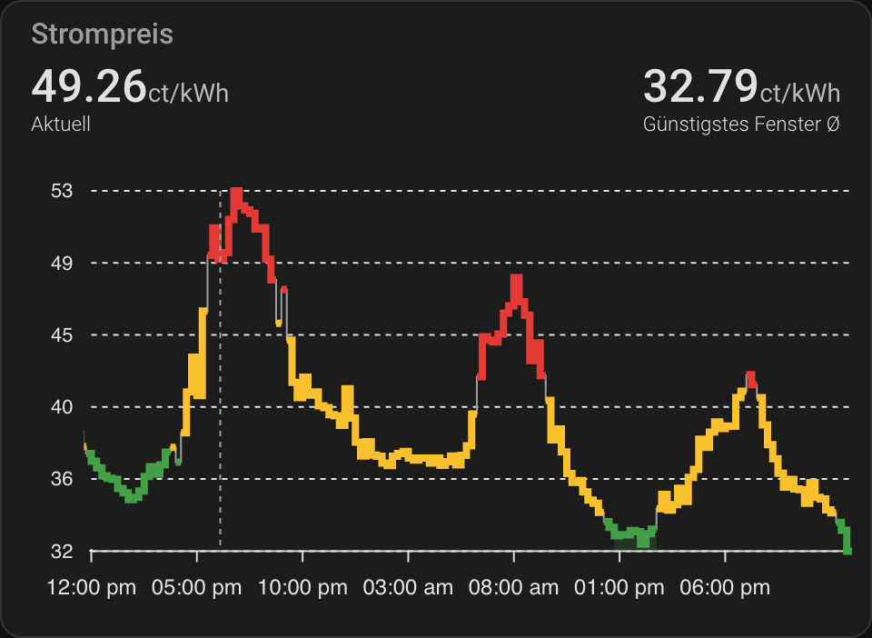
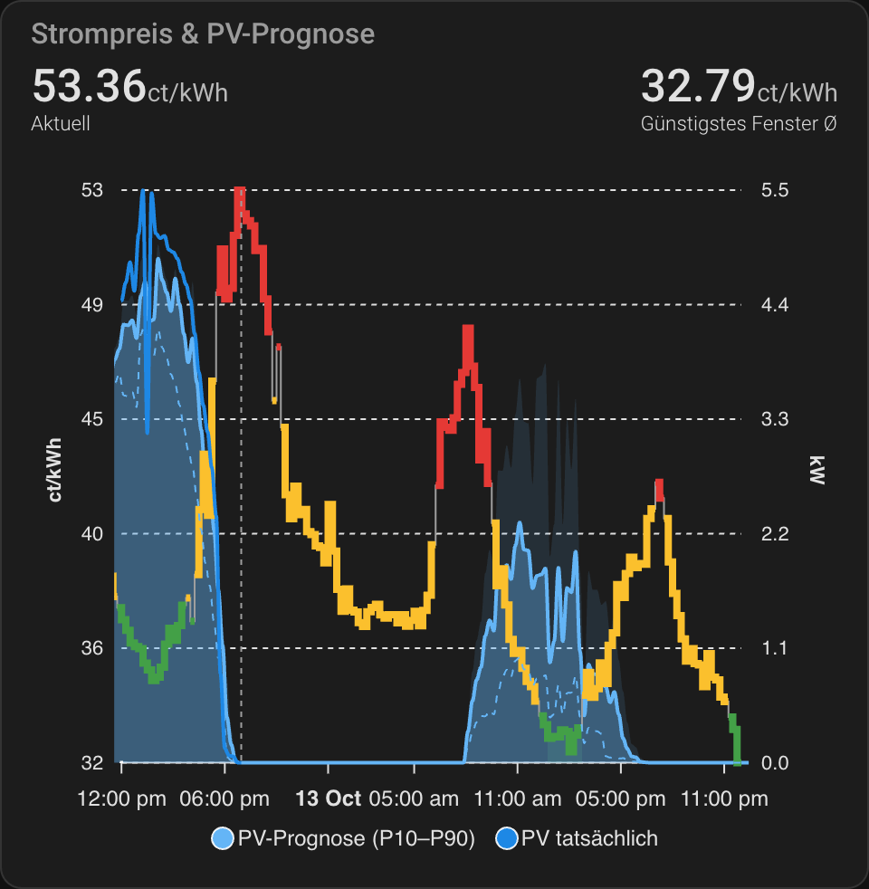

# Tibber-Electricity-Price-Chart-For-Home-Assistant
[English](README.md) | **Deutsch**

Zeigt den aktuellen und kommenden Strompreis deines Tibber.com-Vertrags in Home Assistant an.



- **15-Minuten-Preise** (`QUARTER_HOURLY`), passend zum viertelstündlichen Day-Ahead-Markt. Jeder Preis wird
  zu seiner eigenen `startsAt`-Zeit gezeichnet, dadurch stimmt der Chart auch an Tagen mit Zeitumstellung.
- **Farben relativ zum Tag**: günstig (mindestens 10 % unter dem Tagesdurchschnitt), normal, teuer
  (mindestens 10 % darüber). Feste Cent-Grenzen passen nicht mehr, seit Steuern und Abgaben den Großteil
  des Preises ausmachen.
- **Günstigstes Fenster**: der günstigste zusammenhängende Block ab jetzt (standardmäßig 2 Stunden) wird
  hervorgehoben und steht als `sensor.tibber_cheapest_window` für Automationen bereit, z. B. um die
  Spülmaschine zu starten.
- **Preislimit-Linie**: über `input_number.tibber_price_limit` einstellen (0 = aus).
- **Mitlaufende Ansicht**: 6 Stunden zurück, 30 Stunden voraus.
- **Schont API und Datenbank**: Die Preisliste wird alle 15 Minuten abgefragt und nicht im Recorder
  gespeichert; der aktuelle Preis wird jede Minute lokal berechnet.

## Einrichtung

 1. Packages in der `configuration.yaml` aktivieren (überspringen, falls schon vorhanden):
    ```yaml
    homeassistant:
      packages: !include_dir_named packages
    ```
 2. `packages/tibber_prices.yaml` aus diesem Repository in den Ordner `packages` deiner Home-Assistant-Konfiguration
    kopieren (neben der `configuration.yaml` anlegen, falls es ihn noch nicht gibt)
 3. Deinen Tibber Developer Token (https://developer.tibber.com/) mit `Bearer ` davor in die `secrets.yaml` eintragen:
    ```yaml
    tibber_token: "Bearer DEIN_TIBBER_DEVELOPER_TOKEN"
    ```
 4. https://github.com/RomRider/apexcharts-card über HACS installieren
 5. Home Assistant neu starten
 6. In einem beliebigen Dashboard eine neue Karte hinzufügen und den Inhalt von `card.de.yaml` einfügen
    (englische Beschriftung: `card.yaml`)

Hat deine `configuration.yaml` schon einen `recorder:`-Abschnitt mit `exclude:`, meldet Home Assistant einen
Konflikt. Dann den `recorder:`-Teil des Packages in dein bestehendes `exclude:` übernehmen.

### Entitäten

| Entität | Beschreibung |
|---|---|
| `sensor.tibber_price` | Aktueller Preis in EUR/kWh |
| `sensor.tibber_cheapest_window` | Beginn des günstigsten Fensters; Attribute `end` und `average` (ct/kWh) |
| `input_number.tibber_cheapest_window_hours` | Länge des günstigsten Fensters (nach jedem Neustart 2 h; für einen anderen festen Wert `initial` im Package ändern) |
| `input_number.tibber_price_limit` | Limit-Linie im Chart in ct/kWh (0 = aus) |
| `sensor.tibber_price_data` | Alle Preise von heute und morgen (Attribute `today`, `tomorrow`), für den Chart |

**Lieber Stundenpreise?** Im Package `resolution: QUARTER_HOURLY` durch `resolution: HOURLY` ersetzen.
Alles andere funktioniert mit beidem.

**Mehrere Zuhause?** Das Package liest das erste Zuhause (`homes[0]`). Bei Bedarf den Index in
`json_attributes_path` und `value_template` ändern.

### Umstieg von der alten `sensors.yaml`

Den alten REST-Sensor `Tibber Prices` entfernen (und die Zeile `sensor: !include sensors.yaml`, falls sie sonst
nichts einbindet), dann die Schritte oben ausführen. Die alte Entität `sensor.tibber_prices` wird durch
`sensor.tibber_price` und `sensor.tibber_price_data` ersetzt; Automationen, Dashboards und das Energie-Dashboard
(*Einstellungen → Dashboards → Energie*, Preis für den Netzbezug) umstellen, falls sie sie verwendet haben.

## Variante: Preis + PV-Prognose

`card-pv.de.yaml` zeigt die erwartete PV-Produktion neben dem Preis (rechte Achse, kW). Eine teure Stunde ist
kein Problem, wenn viel Sonne kommt.



- PV in Blau, damit es sich nicht mit den Preisfarben mischt
- PV-Prognose (Median) als hellblaue Fläche, die optimistische Prognose (P90) als blasse Fläche dahinter und
  die pessimistische (P10) als gestrichelte Linie
- Tatsächliche PV-Produktion der letzten Stunden als dunkelblaue Linie, so siehst du, wie gut die Prognose
  heute passt
- Optional: eine Linie für die Grundlast deines Hauses (am Ende der Karte auskommentiert)

Sie nutzt [Machine-Learning-Based PV Forecast](https://github.com/dominikamann/ha-machine-learning-based-pv-forecast):

 1. Den Preis-Chart wie oben beschrieben einrichten
 2. [Machine-Learning-Based PV Forecast](https://github.com/dominikamann/ha-machine-learning-based-pv-forecast) installieren und einrichten
 3. Den Inhalt von `card-pv.de.yaml` (englische Beschriftung: `card-pv.yaml`) in eine neue Karte einfügen
 4. `sensor.YOUR_PV_POWER` durch deinen PV-Leistungssensor ersetzen (in W; ist er in kW, die Zeile `transform` löschen)
 5. Die Karte nutzt `sensor.pv_forecast_total_prognoseverlauf` (deutsche Home-Assistant-Sprache). Heißt die
    Entität bei dir anders, etwa `sensor.pv_forecast_total_forecast_curve` bei englischer Sprache, entsprechend
    anpassen. Statt der Summe kannst du auch die Kurve einer einzelnen Anlage verwenden.

---

<sub>Ursprüngliche Idee: [BerriJ](https://community.home-assistant.io/u/berrij/summary) in der
[Home-Assistant-Community](https://community.home-assistant.io/t/tibber-schedul-prices-upcoming-24-hours-prices/391565).</sub>

---

<p align="center">Proudly provided by <a href="https://amannlabs.eu">amannlabs.eu</a></p>
